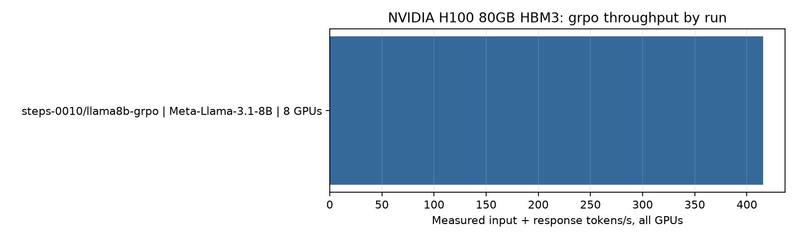
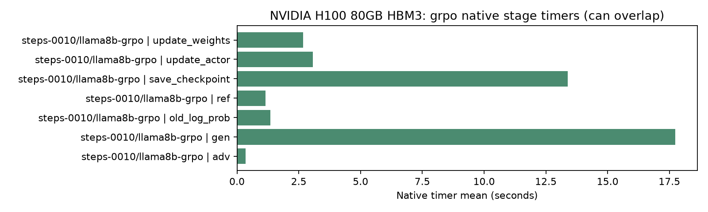
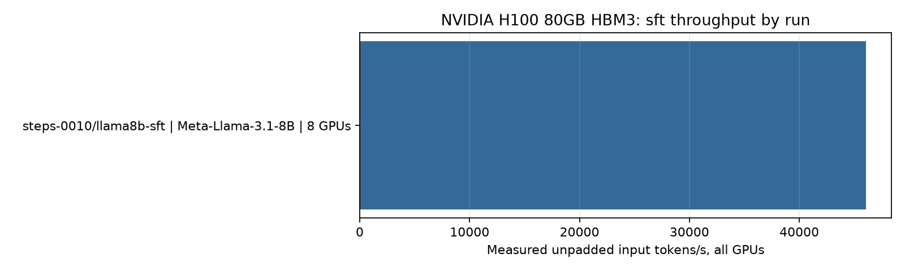
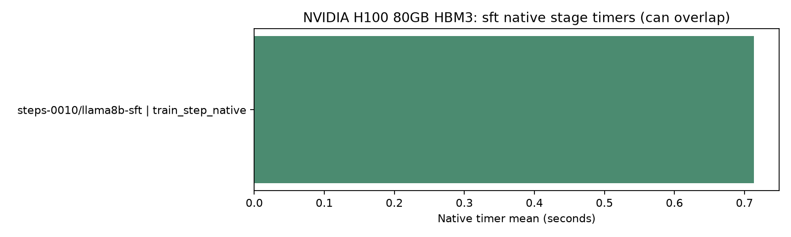
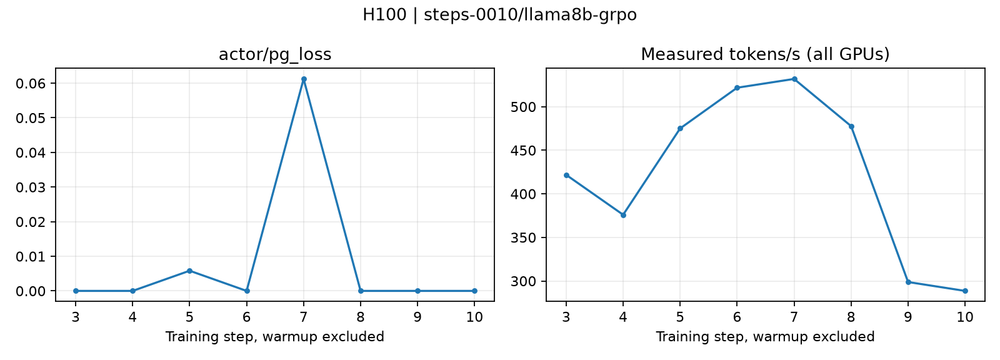
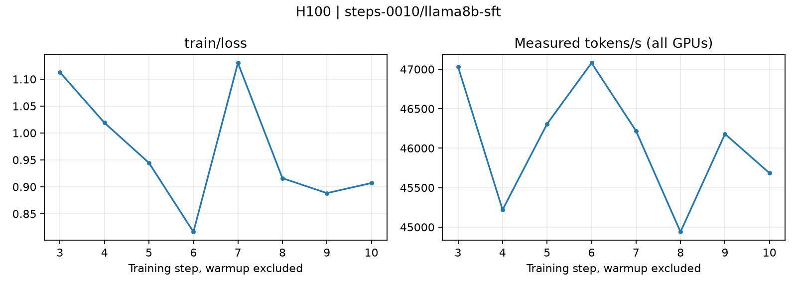

# Performance and scalability evidence

This report contains recorded observations and arithmetic derived from those observations. It does not extrapolate H100 measurements to GH200 or unmeasured cluster sizes.

Discovered attempts: 4. Completed measurements: 2. Review exclusions: 0. Failed, running, incomplete, and review-excluded attempts remain in the inventory. They do not contribute to plots or scaling comparisons. A review exclusion preserves the recorded execution status and original observations; its reason appears in Table 6.

## Table 1. Environment and evidence

| Run | Status | Evidence label | Observed GPU models | Allocated GPUs / nodes | GPU inventory memory | Driver | verl commit |
| --- | --- | --- | --- | --- | --- | --- | --- |
| steps-0010/llama8b-grpo | passed | h100_quick | NVIDIA H100 80GB HBM3 | 8 / 1 | 81559 MiB | 575.57.08 | 1876b06d0a3e4e71e06230be10af14492ca8a75b |
| steps-0010/llama8b-sft | passed | h100_quick | NVIDIA H100 80GB HBM3 | 8 / 1 | 81559 MiB | 575.57.08 | 1876b06d0a3e4e71e06230be10af14492ca8a75b |
| steps-0010/qwen27b-grpo | failed | h100_quick | NVIDIA H100 80GB HBM3 | 8 / 1 | 81559 MiB | 575.57.08 | 1876b06d0a3e4e71e06230be10af14492ca8a75b |
| steps-0010/qwen27b-sft | failed | h100_quick | NVIDIA H100 80GB HBM3 | 8 / 1 | 81559 MiB | 575.57.08 | 1876b06d0a3e4e71e06230be10af14492ca8a75b |

GPU model labels use the CUDA-visible device probe when available, otherwise the recorded nvidia-smi inventory. GPU memory describes the nvidia-smi inventory. Allocation counts come from the run configuration, not inventory length. A6000 and H100 observations appear in separate figures. An evidence label does not override the recorded GPU model.

| Run | Framework versions | Benchmark commit | Source tree SHA256 | Source changes |
| --- | --- | --- | --- | --- |
| steps-0010/llama8b-grpo | {&quot;flash-attn&quot;: &quot;2.8.3&quot;, &quot;pyarrow&quot;: &quot;24.0.0&quot;, &quot;ray&quot;: &quot;2.55.1&quot;, &quot;torch&quot;: &quot;2.11.0+cu130&quot;, &quot;transformers&quot;: &quot;5.9.0&quot;, &quot;verl&quot;: &quot;0.9.1&quot;, &quot;vllm&quot;: &quot;0.24.0&quot;} | e44796a0e6b8c82a36ade9e5b916d68dba18c2d3 | dd23680a7f553da50197021379c4b8aef28c0ced3bfe42e7953ae14da8379f47 | ?? outputs/ |
| steps-0010/llama8b-sft | {&quot;flash-attn&quot;: &quot;2.8.3&quot;, &quot;pyarrow&quot;: &quot;24.0.0&quot;, &quot;ray&quot;: &quot;2.55.1&quot;, &quot;torch&quot;: &quot;2.11.0+cu130&quot;, &quot;transformers&quot;: &quot;5.9.0&quot;, &quot;verl&quot;: &quot;0.9.1&quot;, &quot;vllm&quot;: &quot;0.24.0&quot;} | e44796a0e6b8c82a36ade9e5b916d68dba18c2d3 | dd23680a7f553da50197021379c4b8aef28c0ced3bfe42e7953ae14da8379f47 | none recorded |
| steps-0010/qwen27b-grpo | {&quot;flash-attn&quot;: &quot;2.8.3&quot;, &quot;pyarrow&quot;: &quot;24.0.0&quot;, &quot;ray&quot;: &quot;2.55.1&quot;, &quot;torch&quot;: &quot;2.11.0+cu130&quot;, &quot;transformers&quot;: &quot;5.9.0&quot;, &quot;verl&quot;: &quot;0.9.1&quot;, &quot;vllm&quot;: &quot;0.24.0&quot;} | e44796a0e6b8c82a36ade9e5b916d68dba18c2d3 | dd23680a7f553da50197021379c4b8aef28c0ced3bfe42e7953ae14da8379f47 | ?? outputs/ |
| steps-0010/qwen27b-sft | {&quot;flash-attn&quot;: &quot;2.8.3&quot;, &quot;pyarrow&quot;: &quot;24.0.0&quot;, &quot;ray&quot;: &quot;2.55.1&quot;, &quot;torch&quot;: &quot;2.11.0+cu130&quot;, &quot;transformers&quot;: &quot;5.9.0&quot;, &quot;verl&quot;: &quot;0.9.1&quot;, &quot;vllm&quot;: &quot;0.24.0&quot;} | e44796a0e6b8c82a36ade9e5b916d68dba18c2d3 | dd23680a7f553da50197021379c4b8aef28c0ced3bfe42e7953ae14da8379f47 | ?? outputs/ |

| Run | CPU | Logical CPUs | Host RAM (GiB) | CUDA runtime | Framework lane | Topology captured |
| --- | --- | --- | --- | --- | --- | --- |
| steps-0010/llama8b-grpo | Intel(R) Xeon(R) Platinum 8468 | 192 | 2015.5 | 13.0 | h100 | True |
| steps-0010/llama8b-sft | Intel(R) Xeon(R) Platinum 8468 | 192 | 2015.5 | 13.0 | h100 | True |
| steps-0010/qwen27b-grpo | Intel(R) Xeon(R) Platinum 8468 | 192 | 2015.5 | 13.0 | h100 | True |
| steps-0010/qwen27b-sft | Intel(R) Xeon(R) Platinum 8468 | 192 | 2015.5 | 13.0 | h100 | True |

## Table 2. Workload configuration

| Run | Model / revision | Mode | Sequence limit | Global / micro batch | Prompt / response limits | Rollout group | dtype | Measured / warmup steps |
| --- | --- | --- | --- | --- | --- | --- | --- | --- |
| steps-0010/llama8b-grpo | meta-llama/Meta-Llama-3.1-8B @ d04e592bb4f6aa9cfee91e2e20afa771667e1d4b | grpo | 3072 | 8 / 1 | 2048 / 1024 | 4 | bfloat16 | 8 / 2 |
| steps-0010/llama8b-sft | meta-llama/Meta-Llama-3.1-8B @ d04e592bb4f6aa9cfee91e2e20afa771667e1d4b | sft | 4096 | 8 / 1 | 2048 / 1024 | 4 | bfloat16 | 8 / 2 |
| steps-0010/qwen27b-grpo | Qwen/Qwen3.8-27B @ 1d4bf0f2ff6012fd82039f2fa52739d0dd7c60c0 | grpo | 3072 | 8 / 1 | 2048 / 1024 | 4 | bfloat16 | 0 / 2 |
| steps-0010/qwen27b-sft | Qwen/Qwen3.8-27B @ 1d4bf0f2ff6012fd82039f2fa52739d0dd7c60c0 | sft | 4096 | 8 / 1 | 2048 / 1024 | 4 | bfloat16 | 0 / 2 |

Sequence settings are limits, not observed token counts. SFT uses trajectory-derived supervision. GRPO uses generated responses and bounded code-output rewards. It does not include repository edits, shell tools, or SWE-bench evaluation.

## Table 3. Measured performance

| Run | Status | Comparison excluded | Tokens/s, all GPUs | Tokens/s/GPU | Step mean / median / p95 (s) | Native peak allocated (GiB) | Tokens observed | Time observed (s) |
| --- | --- | --- | --- | --- | --- | --- | --- | --- |
| steps-0010/llama8b-grpo | passed | False | 415.801 | 51.9751 | 28.1908 / 27.02 / 38.5563 | 11.5597 | 93774 | 225.526 |
| steps-0010/llama8b-sft | passed | False | 46079.8 | 5759.97 | 0.703009 / 0.703851 / 0.708975 | 10.7265 | 259156 | 5.62407 |
| steps-0010/qwen27b-grpo | failed | False | — | — | — / — / — | — | 0 | 0 |
| steps-0010/qwen27b-sft | failed | False | — | — | — / — / — | — | 0 | 0 |

Token counts are already aggregated across all ranks. Tokens/s/GPU divides aggregate tokens/s by total allocated GPUs exactly once. SFT counts unpadded input tokens, including masked prompts. GRPO counts prompt plus generated response tokens. These values are not response-only generation rates or supervised-target-only token rates. Missing values remain empty in CSV and appear as — here. Partial failed-run values are diagnostic observations, not completed benchmark results.

## Proxy response costs

| Run | Status | Observed response samples | Responses/s | GPU-seconds/response |
| --- | --- | --- | --- | --- |
| steps-0010/llama8b-grpo | passed | 255 | — | — |
| steps-0010/qwen27b-grpo | failed | 0 | — | — |

Response metrics use the actual rollout-dump sample count after warmup and the measured total GRPO step time. They include the bounded proxy iteration, not generation time alone. A response is one sampled code-output answer, not a multi-turn agent trajectory. The report leaves these metrics missing when the summary does not establish them.

## GPU device telemetry

| Run | Status | GPU UUID | Recorded interval | Samples: utilization / memory / power | Mean utilization (%) | Sampled peak memory (MiB) | Mean power (W) |
| --- | --- | --- | --- | --- | --- | --- | --- |
| steps-0010/llama8b-grpo | passed | GPU-0a0b3e04-5ddc-4456-7c89-98134d8bf688 | allocated GPUs, complete framework subprocess lifetime | 622 / 622 / 622 | 17.3135 | 32323 | 143.202 |
| steps-0010/llama8b-grpo | passed | GPU-0f944f51-7dd9-d625-90a2-3dd8e3aec71e | allocated GPUs, complete framework subprocess lifetime | 622 / 622 / 622 | 13.2588 | 32327 | 135.493 |
| steps-0010/llama8b-grpo | passed | GPU-17508db6-b219-f8b0-4e2b-75c6c4ec4a7f | allocated GPUs, complete framework subprocess lifetime | 622 / 622 / 622 | 15.1399 | 32325 | 137.943 |
| steps-0010/llama8b-grpo | passed | GPU-1ffb4cdf-85a0-c868-5997-35ed0dd44486 | allocated GPUs, complete framework subprocess lifetime | 622 / 622 / 622 | 17.0595 | 32325 | 147.238 |
| steps-0010/llama8b-grpo | passed | GPU-912d8533-d421-098a-9315-bcd699293498 | allocated GPUs, complete framework subprocess lifetime | 622 / 622 / 622 | 14.1624 | 32325 | 141.609 |
| steps-0010/llama8b-grpo | passed | GPU-a663b9da-4335-c8a1-47c0-0d307e24de39 | allocated GPUs, complete framework subprocess lifetime | 622 / 622 / 622 | 13.5547 | 32339 | 140.376 |
| steps-0010/llama8b-grpo | passed | GPU-bd89df38-0749-652c-55b0-7841a3db7cd3 | allocated GPUs, complete framework subprocess lifetime | 622 / 622 / 622 | 14.4936 | 32309 | 146.439 |
| steps-0010/llama8b-grpo | passed | GPU-d916f720-833f-189a-35e8-92c0b1c78d9b | allocated GPUs, complete framework subprocess lifetime | 622 / 622 / 622 | 11.709 | 32323 | 131.634 |
| steps-0010/llama8b-sft | passed | GPU-0a0b3e04-5ddc-4456-7c89-98134d8bf688 | allocated GPUs, complete framework subprocess lifetime | 109 / 109 / 109 | 12.1927 | 19745 | 133.39 |
| steps-0010/llama8b-sft | passed | GPU-0f944f51-7dd9-d625-90a2-3dd8e3aec71e | allocated GPUs, complete framework subprocess lifetime | 109 / 109 / 109 | 12.4128 | 19745 | 136.04 |
| steps-0010/llama8b-sft | passed | GPU-17508db6-b219-f8b0-4e2b-75c6c4ec4a7f | allocated GPUs, complete framework subprocess lifetime | 109 / 109 / 109 | 12.0459 | 18743 | 134.649 |
| steps-0010/llama8b-sft | passed | GPU-1ffb4cdf-85a0-c868-5997-35ed0dd44486 | allocated GPUs, complete framework subprocess lifetime | 109 / 109 / 109 | 12.7248 | 19745 | 135.058 |
| steps-0010/llama8b-sft | passed | GPU-912d8533-d421-098a-9315-bcd699293498 | allocated GPUs, complete framework subprocess lifetime | 109 / 109 / 109 | 12.5046 | 19745 | 137.498 |
| steps-0010/llama8b-sft | passed | GPU-a663b9da-4335-c8a1-47c0-0d307e24de39 | allocated GPUs, complete framework subprocess lifetime | 109 / 109 / 109 | 8.57798 | 19681 | 135.982 |
| steps-0010/llama8b-sft | passed | GPU-bd89df38-0749-652c-55b0-7841a3db7cd3 | allocated GPUs, complete framework subprocess lifetime | 109 / 109 / 109 | 12.2661 | 17065 | 139.295 |
| steps-0010/llama8b-sft | passed | GPU-d916f720-833f-189a-35e8-92c0b1c78d9b | allocated GPUs, complete framework subprocess lifetime | 109 / 109 / 109 | 12.6147 | 18743 | 132.806 |
| steps-0010/qwen27b-grpo | failed | GPU-0a0b3e04-5ddc-4456-7c89-98134d8bf688 | allocated GPUs, complete framework subprocess lifetime | 1035 / 1035 / 1035 | 21.4415 | 35209 | 112.864 |
| steps-0010/qwen27b-grpo | failed | GPU-0f944f51-7dd9-d625-90a2-3dd8e3aec71e | allocated GPUs, complete framework subprocess lifetime | 1035 / 1035 / 1035 | 21.2058 | 34729 | 116.73 |
| steps-0010/qwen27b-grpo | failed | GPU-17508db6-b219-f8b0-4e2b-75c6c4ec4a7f | allocated GPUs, complete framework subprocess lifetime | 1035 / 1035 / 1035 | 18.087 | 35113 | 113.53 |
| steps-0010/qwen27b-grpo | failed | GPU-1ffb4cdf-85a0-c868-5997-35ed0dd44486 | allocated GPUs, complete framework subprocess lifetime | 1035 / 1035 / 1035 | 19.8821 | 35209 | 114.947 |
| steps-0010/qwen27b-grpo | failed | GPU-912d8533-d421-098a-9315-bcd699293498 | allocated GPUs, complete framework subprocess lifetime | 1035 / 1035 / 1035 | 20.5874 | 35209 | 117.97 |
| steps-0010/qwen27b-grpo | failed | GPU-a663b9da-4335-c8a1-47c0-0d307e24de39 | allocated GPUs, complete framework subprocess lifetime | 1035 / 1035 / 1035 | 6.35169 | 35529 | 116.414 |
| steps-0010/qwen27b-grpo | failed | GPU-bd89df38-0749-652c-55b0-7841a3db7cd3 | allocated GPUs, complete framework subprocess lifetime | 1035 / 1035 / 1035 | 20.9111 | 35209 | 121.205 |
| steps-0010/qwen27b-grpo | failed | GPU-d916f720-833f-189a-35e8-92c0b1c78d9b | allocated GPUs, complete framework subprocess lifetime | 1035 / 1035 / 1035 | 18.9295 | 34729 | 113.026 |
| steps-0010/qwen27b-sft | failed | GPU-0a0b3e04-5ddc-4456-7c89-98134d8bf688 | allocated GPUs, complete framework subprocess lifetime | 351 / 351 / 351 | 15.3647 | 10979 | 109.225 |
| steps-0010/qwen27b-sft | failed | GPU-0f944f51-7dd9-d625-90a2-3dd8e3aec71e | allocated GPUs, complete framework subprocess lifetime | 351 / 351 / 351 | 15.2051 | 10979 | 111.671 |
| steps-0010/qwen27b-sft | failed | GPU-17508db6-b219-f8b0-4e2b-75c6c4ec4a7f | allocated GPUs, complete framework subprocess lifetime | 351 / 351 / 351 | 15.1681 | 10979 | 109.186 |
| steps-0010/qwen27b-sft | failed | GPU-1ffb4cdf-85a0-c868-5997-35ed0dd44486 | allocated GPUs, complete framework subprocess lifetime | 351 / 351 / 351 | 15.1026 | 10979 | 111.063 |
| steps-0010/qwen27b-sft | failed | GPU-912d8533-d421-098a-9315-bcd699293498 | allocated GPUs, complete framework subprocess lifetime | 351 / 351 / 351 | 15.1026 | 10979 | 114.215 |
| steps-0010/qwen27b-sft | failed | GPU-a663b9da-4335-c8a1-47c0-0d307e24de39 | allocated GPUs, complete framework subprocess lifetime | 351 / 351 / 351 | 0.689459 | 11287 | 112.404 |
| steps-0010/qwen27b-sft | failed | GPU-bd89df38-0749-652c-55b0-7841a3db7cd3 | allocated GPUs, complete framework subprocess lifetime | 351 / 351 / 351 | 15.1225 | 10979 | 117.041 |
| steps-0010/qwen27b-sft | failed | GPU-d916f720-833f-189a-35e8-92c0b1c78d9b | allocated GPUs, complete framework subprocess lifetime | 351 / 351 / 351 | 15.1254 | 10979 | 109.334 |

Native peak allocated memory comes from framework allocator statistics. Device telemetry comes from periodic nvidia-smi samples. Device memory includes allocations outside that allocator, and sampling can miss short peaks. Telemetry covers the complete framework process, including initialization and warmup. It does not share the post-warmup timing interval. The per-device statistics and their scope remain in measurements.csv and summary.json. Missing telemetry is not zero utilization.

## Training and reward evidence

| Run | Mode | Gradient samples / mean / max | Nonzero gradient observed | Reward signal observed | Groups with reward variation | Proxy accuracy | Warnings |
| --- | --- | --- | --- | --- | --- | --- | --- |
| steps-0010/llama8b-grpo | grpo | 8 / 1.37354 / 3.76562 | True | False | 0.047619 | 0 | No reward variation observed; GRPO learning signal is unverified. |
| steps-0010/llama8b-sft | sft | 8 / 62.1094 / 123.5 | True | — | — | — | — |
| steps-0010/qwen27b-grpo | grpo | — / — / — | False | False | — | — | No nonzero gradient recorded; throughput does not establish a useful model update.; No reward variation observed; GRPO learning signal is unverified. |
| steps-0010/qwen27b-sft | sft | — / — / — | False | — | — | — | No nonzero gradient recorded; throughput does not establish a useful model update. |

A passed status establishes completed measurement execution. It does not establish convergence or model improvement. Zero or missing gradient evidence and zero or unverified reward variation limit the result to measured execution. Proxy accuracy measures code-output answers only. It is not a repository-repair score. Gradient sample counts preserve the recorded interval; older captures can include warmup. The full reward audit, including malformed rows and incomplete groups, remains in measurements.csv and summary.json.

## Table 4. Native stage timings

| Run | Status | Timer | Observations | Mean (s) | Median (s) | p95 (s) |
| --- | --- | --- | --- | --- | --- | --- |
| steps-0010/llama8b-grpo | passed | timing_s/adv | 8 | 0.343739 | 0.327934 | 0.400583 |
| steps-0010/llama8b-grpo | passed | timing_s/gen | 8 | 17.7458 | 17.6313 | 19.2734 |
| steps-0010/llama8b-grpo | passed | timing_s/old_log_prob | 8 | 1.3465 | 1.29801 | 1.91014 |
| steps-0010/llama8b-grpo | passed | timing_s/ref | 8 | 1.15625 | 1.11807 | 1.53204 |
| steps-0010/llama8b-grpo | passed | timing_s/save_checkpoint | 1 | 13.3938 | 13.3938 | 13.3938 |
| steps-0010/llama8b-grpo | passed | timing_s/step | 8 | 28.1908 | 27.02 | 38.5563 |
| steps-0010/llama8b-grpo | passed | timing_s/update_actor | 8 | 3.07558 | 2.97817 | 4.20582 |
| steps-0010/llama8b-grpo | passed | timing_s/update_weights | 8 | 2.66841 | 2.62813 | 3.70472 |
| steps-0010/llama8b-sft | passed | timing_s/train_step | 8 | 0.703009 | 0.703851 | 0.708975 |
| steps-0010/llama8b-sft | passed | timing_s/train_step_native | 8 | 0.713777 | 0.714477 | 0.719214 |

Native timers may overlap or contain other timers. Do not sum them to infer total RL time. Only the native total-step timer measures the bounded proxy iteration. Nested agent-loop fields are omitted because that namespace also contains counts without a seconds contract.

## Table 5. Matched strong scaling

No qualifying matched measurements span two GPU counts. No scaling curve or efficiency is inferred.

Scaling groups require the same model revision, GPU model, framework versions, verl commit, benchmark source, dataset content, and workload configuration. Benchmark source identity uses the captured source-tree SHA256, or a clean Git commit when no tree hash exists. Global batch, sequence lengths, rollout group, seed, precision, microbatch, and measured-step count must match. Each GPU count uses the arithmetic mean of all completed, non-excluded repetitions in that group. No best-run selection occurs. Efficiency = throughput(N) / throughput(N0) × N0 / N. A single observation has no estimated sample deviation.

## Table 6. Failures, omissions, and comparison limits

| Run | Status | Comparison excluded | Review reason | Problems | Scaling exclusion |
| --- | --- | --- | --- | --- | --- |
| steps-0010/llama8b-grpo | passed | False | — | — | signature recorded; no matching different GPU count |
| steps-0010/llama8b-sft | passed | False | — | — | signature recorded; no matching different GPU count |
| steps-0010/qwen27b-grpo | failed | False | — | framework_exit_code=1; incomplete_steps=0/10; no_measured_steps_after_warmup | completed measurement required |
| steps-0010/qwen27b-sft | failed | False | — | framework_exit_code=1; incomplete_steps=0/10; no_measured_steps_after_warmup | completed measurement required |

## Capture policy and retained artifacts

| Run | Capture enabled / cadence | Checkpoint enabled / cadence / keep all | Indexed files / logical bytes | Symlinks | Capture files | Checkpoint files | Post-run hashing (s) | Index / capture errors |
| --- | --- | --- | --- | --- | --- | --- | --- | --- |
| steps-0010/llama8b-grpo | True / 1 | True / 10 / True | 1007 / 48313598807 | 12 | 169 | 32 | 1.14491 | 0 / [] |
| steps-0010/llama8b-sft | True / 1 | True / 10 / True | 473 / 48214775635 | 12 | 376 | 39 | 0.251012 | 0 / [] |
| steps-0010/qwen27b-grpo | True / 1 | True / 10 / True | 783 / 72661544 | 0 | 20 | none observed | 0.390463 | 0 / [] |
| steps-0010/qwen27b-sft | True / 1 | True / 10 / True | 87 / 4119283 | 0 | 32 | none observed | 0.130821 | 0 / [] |

[Raw artifact index with file links](artifacts.md) · [Artifact inventory CSV](artifacts.csv). Capture and checkpoint policies are requested configuration, not proof of successful capture. The inventory records files present at report generation, including failed and review-excluded attempts. Logical file bytes do not measure physical filesystem usage. Symlink targets are not added to the byte total. Native capture manifests record per-process capture duration and payload hashes when available. Their elapsed_s covers CPU copy, payload serialization, and hashing, excluding TransferQueue materialization and metadata/manifest writes. It is not total capture overhead. Absent timing remains unknown. Do not add concurrent capture durations or subtract them from native step timing. Checkpoint presence does not establish resume support or model convergence.

## Figures

H100 grpo: each bar is one completed run. Configurations remain separate. [SVG](figures/benchkit-throughput-nvidia-h100-80gb-hbm3-grpo-f56b1a0a.svg)

H100 grpo: stage timers are not additive and may overlap. [SVG](figures/benchkit-stages-nvidia-h100-80gb-hbm3-grpo-a0157caa.svg)

H100 sft: each bar is one completed run. Configurations remain separate. [SVG](figures/benchkit-throughput-nvidia-h100-80gb-hbm3-sft-34d56813.svg)

H100 sft: stage timers are not additive and may overlap. [SVG](figures/benchkit-stages-nvidia-h100-80gb-hbm3-sft-e455117e.svg)

steps-0010/llama8b-grpo: observed step traces after warmup exclusion. [SVG](figures/benchkit-trace-steps-0010-llama8b-grpo-e9dd3c33.svg)

steps-0010/llama8b-sft: observed step traces after warmup exclusion. [SVG](figures/benchkit-trace-steps-0010-llama8b-sft-11cd8e58.svg)

## Machine-readable outputs

[Measurements](measurements.csv), [native stage timings](stages.csv), and [matched scaling](scaling.csv). [Raw artifacts](artifacts.md) and [artifact inventory](artifacts.csv) retain links to intermediate evidence. The original per-run configuration, environment, manifest, summary, metrics, and framework logs remain the primary evidence. An optional review.json records an additive comparison exclusion with exclude_from_comparisons: true and a reason string. It does not edit the captured evidence.

## Campaign plan and execution status

All cases use eight GPUs. Target step counts are not observed completion counts.

| Case | Target steps | State | Reason |
|---|---:|---|---|
| steps-0010/llama8b-sft | 10 | passed |  |
| steps-0010/llama8b-grpo | 10 | passed |  |
| steps-0010/qwen27b-sft | 10 | failed |  |
| steps-0010/qwen27b-grpo | 10 | failed |  |
| steps-0100/llama8b-sft | 100 | pending |  |
| steps-0100/llama8b-grpo | 100 | pending |  |
| steps-0100/qwen27b-sft | 100 | pending |  |
| steps-0100/qwen27b-grpo | 100 | pending |  |
| steps-1000/llama8b-sft | 1000 | pending |  |
| steps-1000/llama8b-grpo | 1000 | pending |  |
| steps-1000/qwen27b-sft | 1000 | pending |  |
| steps-1000/qwen27b-grpo | 1000 | pending |  |

Native per-step metrics and campaign.json retain the underlying evidence.
